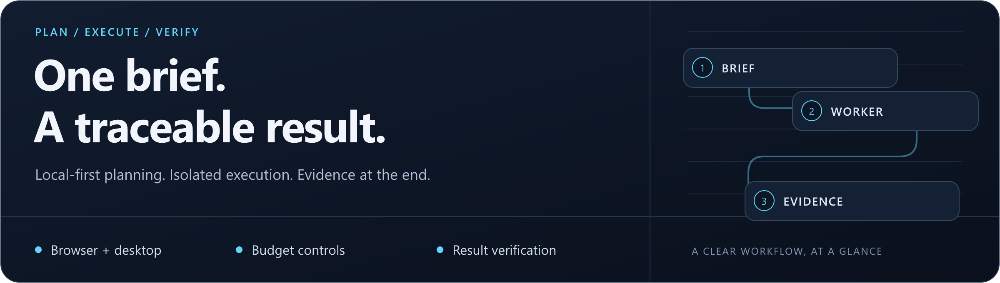

# Extreme Autopilot

<p align="center">
  
</p>

**One task brief. Local-first planning. Isolated execution with evidence.**

Python **3.11+** · Node.js **22.12+** · Windows / Linux / macOS · [MIT](LICENSE)

[](https://github.com/rvnsre/extreme-autopilot/actions/workflows/ci.yml)

[Quick start](#quick-start) · [How it works](#how-it-works) · [Token economy](#token-economy) · [Documentation](#documentation)

> **Project status:** Implementation preview. Synthetic CI passes; live model/VM, native macOS GUI and full 24-hour acceptance remain pending. [Verification details](VALIDATION.md).

## Built for one-brief tasks

Submit a **200–50,000 Unicode-codepoint brief** once. The coordinator plans the work, a dedicated worker runs the tools, and the agent checks the results without asking follow-up questions during execution. Unresolved work is reported as partial or blocked.

| Plan locally | Execute in isolation | Check the result |
| --- | --- | --- |
| Ollama handles routine planning; OpenAI handles escalation, vision and final verification. | Sequential browser, API, desktop, file and process tools run on a dedicated worker. | Receipts, readbacks, tests and an independent verifier support the final report. |

## How it works

```text
Brief → Plan → Tool execution → Observation → Verification → Report + artifacts
                 ↑                    |
                 └── next step ──────┘
```

The host runs FastAPI, SQLite, Ollama and the Azerbaijani dashboard. The worker uses a separate authenticated HTTPS connection. Command journals, idempotent submission and a single worker lease support recovery; uncertain effects are fenced instead of blindly replayed.

| Default | Value | What to know |
| --- | --- | --- |
| Task duration | 24 hours | The task's original deadline bounds execution. |
| Cloud budget | US$5 per task | Application accounting; not a hard provider billing cap. |
| Tool operations | 2,000 | Configurable ceiling, with final verification still required. |
| Worker concurrency | One active task | Other tasks remain queued. |

## Quick start

Clone the source, then choose the coordinator installer for your operating system:

```bash
git clone https://github.com/rvnsre/extreme-autopilot.git
cd extreme-autopilot
```

<details open>
<summary><strong>Windows / PowerShell</strong></summary>

```powershell
.scriptsInstall-Coordinator.ps1
```

</details>

<details>
<summary><strong>Linux / macOS</strong></summary>

```bash
bash scripts/install.sh coordinator
```

</details>

**Before submitting a task:** follow [SETUP.md](docs/SETUP.md) and [PLATFORMS.md](docs/PLATFORMS.md) to configure models, current prices, two different tokens, TLS and a dedicated worker. Keep the env file outside the checkout. The installer alone does not create or license a VM.

Then, on Windows, check the configured models and submit the supplied code example:

```powershell
..venvScriptsautopilot.exe --env-file C:AutopilotDatacoordinator.env doctor --models
..venvScriptsautopilot.exe --env-file C:AutopilotDatacoordinator.env submit --file examplescode.txt
```

On Linux/macOS, use `.venv/bin/autopilot` and an absolute Unix env-file path. Once the coordinator is serving, open the [local dashboard](http://127.0.0.1:8765).

## Token economy

v0.4.0 integrates **22 local libraries and 38 documented improvements**: context extraction and ranking, exact job-scoped plan caching, concurrent-call coalescing, output ceilings and private token diagnostics. Action decisions and final verdicts are never reused from the plan cache.

Four synthetic text fixtures measured **58.59% estimated context reduction** with `cl100k_base`. This is not a live-task accuracy score, an exact count for every model, or measured provider dollar savings. Final evidence bypasses the lossy reducer.

[Read the implementation and settings →](docs/ECONOMY.md) · [Inspect the measurement data →](docs/benchmarks/economy-v040.json)

## Platforms and boundaries

| Platform | Native desktop requirement |
| --- | --- |
| Windows | An unlocked interactive session. |
| Linux | X11; native Wayland desktop input is unsupported. |
| macOS | Initial Accessibility, Screen Recording and Automation permissions; validate on the actual worker. |

Use a disposable VM or dedicated machine with task-only accounts. Generated code runs as the worker's OS user; workspace checks are not an OS sandbox. Missing credentials, CAPTCHAs or unresolved obstacles result in a report rather than a request for more input.

Captured artifacts are limited to **512 KB per file** and file-write calls to **64 KB**. Cancellation is cooperative and cannot undo an external action already submitted. See the [trust model](SECURITY.md).

## Documentation

| Start here | Reference and evidence |
| --- | --- |
| [Host, worker, TLS and accounts](docs/SETUP.md) | [API, CLI, development and operating limits](docs/OPERATIONS.md) |
| [Windows / Linux / macOS setup](docs/PLATFORMS.md) | [Validation and remaining acceptance work](VALIDATION.md) |
| [Token-economy settings and library map](docs/ECONOMY.md) | [Correctness and recovery audit](AUDIT.md) |
| [Synthetic research brief](examples/research.txt) · [Code brief](examples/code.txt) | [Security](SECURITY.md) · [License](LICENSE) |

Found a problem? [Open an issue](https://github.com/rvnsre/extreme-autopilot/issues/new) with your OS, package version and redacted error. Keep keys, private prompts and screenshots out of public reports.

---

**More from rvnsre:** [MedResearch](https://github.com/rvnsre/medresearch-cli) · [ForgeFlow CLI](https://github.com/rvnsre/forgeflow-cli) · [LocalDesk Agent](https://github.com/rvnsre/localdesk-agent)
